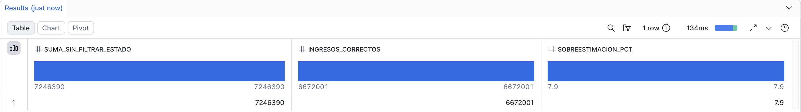
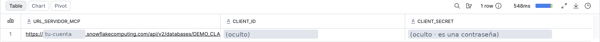
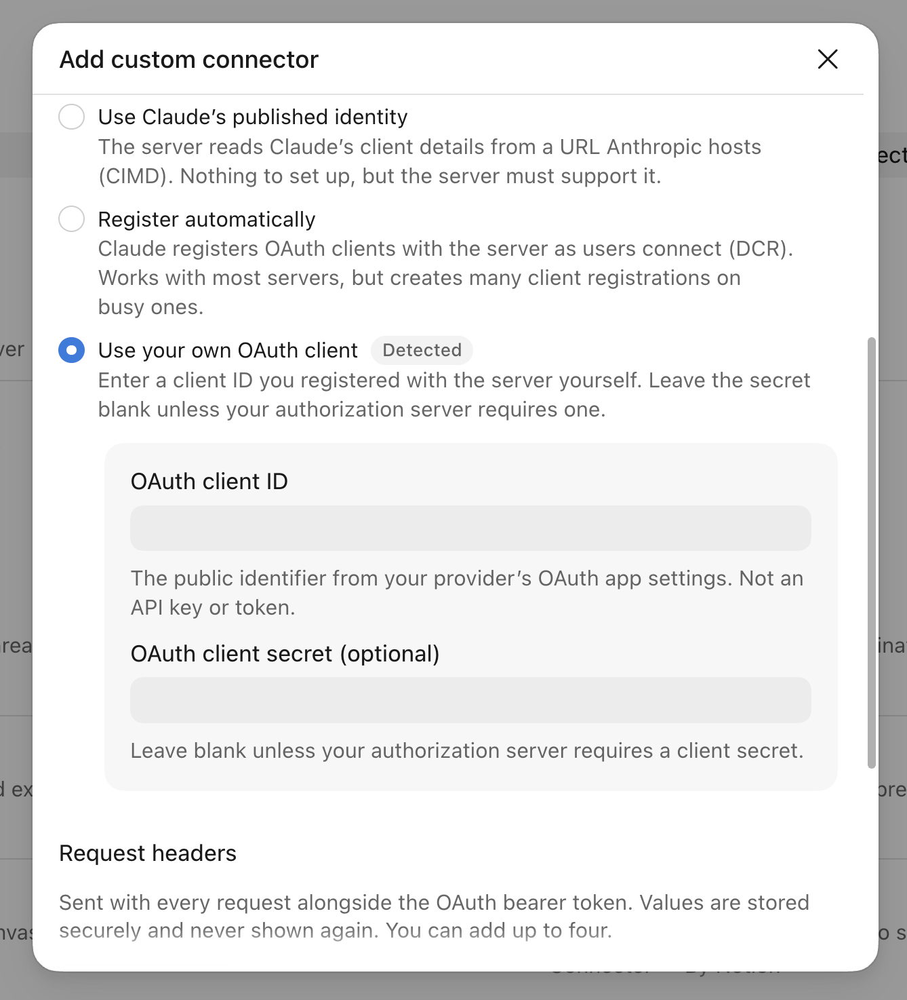
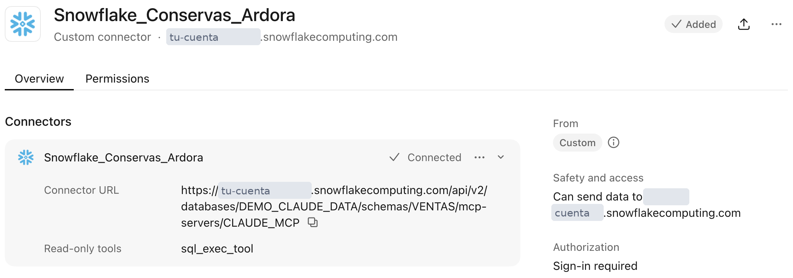
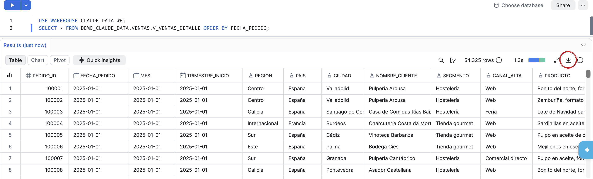
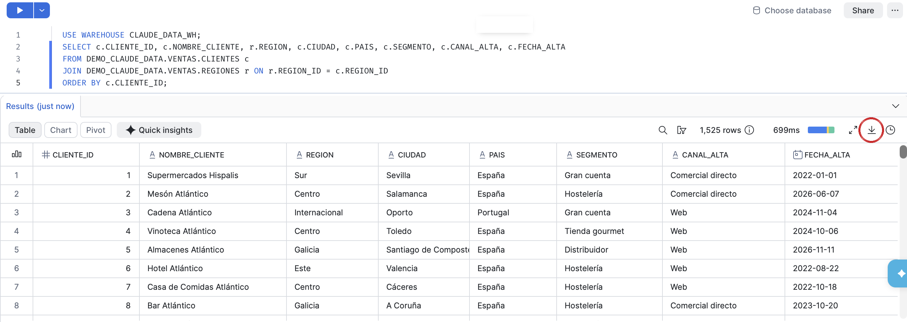

<p align="center">
  
</p>

# Demo de Claude Data con Snowflake · Conservas Ardora

Material para enseñar **Claude Data** sobre una base de datos de ejemplo en **Snowflake**. Incluye scripts SQL que generan los datos, el modelo de datos, el guion de la demo y las consultas para certificar.

La empresa de los datos es **Conservas Ardora, S.L.**, una conservera ficticia fundada en 1945 en **A Illa de Arousa (Pontevedra)**, en plena ría de Arousa, que vende conservas de marisco y pescado de las Rías Baixas a tiendas gourmet, hostelería, distribuidores y cadenas de supermercados de España y del extranjero.

> Todos los datos, nombres de clientes y personas son ficticios y se generan al azar en cada ejecución.

---

## Qué es Claude Data

Claude Data (antes *Claude Dashboards*) convierte preguntas sobre los datos de una empresa en paneles, historias de datos y vídeos cortos narrados. Te conectas a un almacén de datos (Snowflake, BigQuery, Databricks, Redshift o ClickHouse) o a otra app, preguntas en lenguaje natural y Claude escribe y ejecuta el SQL. Cada gráfico muestra su consulta y cuándo se actualizó por última vez.

Documentación oficial:
- [Get started with Claude Data](https://support.claude.com/en/articles/17454700-get-started-with-claude-data)
- [Dashboards and Motion](https://claude.com/resources/articles/dashboards-and-motion)
- [Introducing Claude Whiteboards, Claude Sheets, and Claude Data](https://claude.com/resources/articles/sheets-whiteboards-data)

## Requisitos

| Necesitas | Detalle |
| --- | --- |
| Un plan de pago de Claude | Claude Data está en Pro, Max, Ultra, Team y Enterprise. En Enterprise lo activa un administrador. |
| Una cuenta de Snowflake **de pago** | Con una [cuenta de prueba](https://signup.snowflake.com/) puedes crear los datos (`01_crear_demo.sql`), pero **no conectar Claude**: las cuentas de prueba no permiten usar servidores MCP y Claude recibe el error *Access denied for trial accounts*. Los scripts usan un warehouse X-Small que se apaga a los 60 s. |
| Permisos de ACCOUNTADMIN en Snowflake | Solo para ejecutar el script de creación. Claude se conecta con un rol de solo lectura. |

## Estructura del repositorio

```
.
├── README.md
├── data/
│   ├── ventas_detalle.csv             # Plan B: pedidos exportados de Snowflake
│   └── clientes.csv                   # Plan B: clientes exportados de Snowflake
├── assets/
│   ├── logo-conservas-ardora.jpg      # Logo de la conservera
│   ├── snowflake-resultado.png        # Resultado esperado de 01_crear_demo.sql
│   ├── snowflake-conexion.png         # Resultado de 03_conectar_claude.sql (claves ocultas)
│   ├── claude-conector-oauth.png      # Formulario del conector personalizado en Claude
│   ├── claude-conector-conectado.png  # Conector conectado (cuenta oculta)
│   ├── plan-b-exportar.png            # Plan B: exportar las ventas desde Snowsight
│   └── plan-b-exportar-clientes.png   # Plan B: exportar los clientes desde Snowsight
├── sql/
│   ├── 01_crear_demo.sql              # Crea warehouse, base de datos, tablas, vista y rol de lectura
│   ├── 02_consultas_certificadas.sql  # Consultas para certificar en Claude Data
│   ├── 03_conectar_claude.sql         # Servidor MCP y acceso OAuth para Claude
│   ├── 04_exportar_plan_b.sql         # Plan B: exportar los datos a CSV
│   └── 99_limpieza.sql                # Borra todo lo creado
└── docs/
    ├── modelo-de-datos.md             # Tablas, columnas y relaciones
    └── guion-demo.md                  # Paso a paso de la demo, con los prompts
```

## Puesta en marcha

### 1. Crea los datos en Snowflake

1. En Snowsight, abre **Projects › Workspaces** (antes *Worksheets*) y crea un archivo SQL nuevo con **+**.
2. Pega [`sql/01_crear_demo.sql`](sql/01_crear_demo.sql) y pulsa **Run All**.
3. Comprueba los resultados del apartado 8 del script: volumen de las tablas, variación por región, altas por canal y la sobreestimación al no filtrar por estado.

   Al terminar, Snowsight muestra el resultado de la última consulta (8.4). Debería parecerse a esto (las cifras cambian en cada ejecución):

   

   Sumar todos los pedidos da una cifra ≈ 8 % más alta que sumar solo los completados: es el motivo para certificar la consulta de ingresos.

> Ejecuta el script con **Run All** (flecha junto al botón ▶). El botón ▶ solo ejecuta la consulta donde está el cursor.

Se crea lo siguiente:

| Objeto | Nombre |
| --- | --- |
| Warehouse | `CLAUDE_DATA_WH` (X-Small, se apaga a los 60 s) |
| Base de datos y esquema | `DEMO_CLAUDE_DATA.VENTAS` |
| Tablas | `REGIONES`, `PRODUCTOS`, `CLIENTES`, `PEDIDOS`, `OBJETIVOS` |
| Vista | `V_VENTAS_DETALLE` |
| Rol de solo lectura | `CLAUDE_DATA_LECTOR`, que se asigna al usuario que ejecuta el script |

> **Las fechas son relativas.** Se generan 8 trimestres que terminan **ayer**. Vuelve a ejecutar el script el día antes de grabar o presentar para que «este trimestre» y «este mes» tengan datos frescos. El script borra y recrea la base de datos cada vez. No lo ejecutes el día 1 de un trimestre, porque el trimestre en curso quedaría vacío.

### 2. Conecta Snowflake a Claude

Claude Data consulta Snowflake a través de un **conector**: un servidor MCP que crea el propio Snowflake, con una herramienta SQL de **solo lectura**.

**2.1 · Prepara Snowflake.** Ejecuta [`sql/03_conectar_claude.sql`](sql/03_conectar_claude.sql) con **Run All**. El script:

| Crea | Para qué |
| --- | --- |
| Servidor MCP `DEMO_CLAUDE_DATA.VENTAS.CLAUDE_MCP` | Es la «puerta» por la que Claude ejecuta consultas, solo de lectura, con el warehouse `CLAUDE_DATA_WH` |
| Integración OAuth `CLAUDE_OAUTH` | Permite que Claude inicie sesión en Snowflake en tu nombre. Solo admite el rol `CLAUDE_DATA_LECTOR` |
| Rol por defecto `CLAUDE_DATA_LECTOR` en tu usuario | Claude entra con tu rol por defecto, y Snowflake bloquea `ACCOUNTADMIN` para OAuth. En Snowsight puedes seguir cambiando a `ACCOUNTADMIN` cuando lo necesites |

Al terminar muestra una fila con los tres datos que pide el conector:



> ⚠ **El `CLIENT_SECRET` es una contraseña.** Pégalo solo en el formulario del conector de Claude: nunca en un chat, una diapositiva, una captura ni en GitHub. Si se te escapa, vuelve a ejecutar el script para generar unas claves nuevas; las anteriores dejan de valer.

**2.2 · Añade el conector en Claude.** En Claude, abre **Plugins › Add › conector personalizado** (*Add custom connector*):

| Campo | Valor |
| --- | --- |
| Nombre | `Snowflake_Conservas_Ardora` (o el que quieras) |
| URL | `URL_SERVIDOR_MCP` del paso anterior |
| Tipo de autenticación | **Use your own OAuth client** (Claude lo detecta solo) |
| OAuth client ID | `CLIENT_ID` |
| OAuth client secret | `CLIENT_SECRET`. Aunque el formulario dice *optional*, aquí **es obligatorio** |



Pulsa **Add** y luego **Connect**. Se abre Snowflake en el navegador: inicia sesión, acepta el permiso y, si lo pide, vuelve a la app de escritorio con **Open desktop app**. El conector queda como **Connected**, con una sola herramienta, `sql_exec_tool`, de solo lectura:



> ⚠ **Con una cuenta de prueba de Snowflake el conector aparece como *Connected*, pero las consultas fallan** con `Access denied for trial accounts`. El servidor MCP de Snowflake solo funciona en cuentas de pago.

Claude trabaja con los permisos de la conexión: con el rol `CLAUDE_DATA_LECTOR` solo puede **leer** la base de datos de la demo.

### Plan B · Sin servidor MCP: exporta los datos a CSV

Si tu cuenta de Snowflake es de prueba, Claude no puede consultarla en directo. La demo funciona igual con los datos exportados:

1. Ejecuta las dos consultas de [`sql/04_exportar_plan_b.sql`](sql/04_exportar_plan_b.sql), cada una por separado.
2. Descarga cada resultado en CSV con el botón de descarga de la barra de resultados (marcado en rojo):

   

   

3. En un chat de Claude, adjunta `ventas_detalle.csv` y `clientes.csv` y haz la pregunta de la demo.

> **¿Sin Snowflake?** En la carpeta [`data/`](data) están los dos CSV ya exportados (54.325 pedidos de enero de 2025 al 24 de noviembre de 2026 y 1.525 clientes). Con ellos puedes repetir la demo directamente en Claude.

El panel muestra los datos de los archivos, no una consulta en vivo: si vuelves a generar los datos en Snowflake, exporta de nuevo.

### 3. Haz la demo

Sigue [`docs/guion-demo.md`](docs/guion-demo.md).

### 4. Certifica las consultas clave

[`sql/02_consultas_certificadas.sql`](sql/02_consultas_certificadas.sql) trae tres consultas, cada una con instrucciones para Claude:

- **C1:** ingresos netos por región y trimestre.
- **C2:** ingresos frente a objetivo.
- **C3:** margen bruto por categoría y mes.

Para certificar una consulta, abre la de un gráfico, edítala, activa **Certificar consulta**, añade las instrucciones (una por línea) y pulsa **Probar** y después **Publicar**. Las consultas certificadas están en beta.

### 5. Limpieza

Cuando termines, ejecuta [`sql/99_limpieza.sql`](sql/99_limpieza.sql). Borra la base de datos, el servidor MCP, la integración OAuth, el warehouse y el rol, y devuelve tu rol por defecto a ACCOUNTADMIN. No se puede deshacer. Quita también el conector en Claude › Ajustes › Conectores.

## La historia que esconden los datos

Los datos están preparados para que Claude encuentre algo interesante:

| Hallazgo | Cómo aparece |
| --- | --- |
| Casi todos los mercados crecen en el trimestre en curso | En los datos de `data/`: +32,8 % en total frente al mismo periodo del trimestre anterior |
| **Sur es la única región que cae** | −1,5 % en los datos de `data/`: la cadena *Supermercados Hispalis* (Sevilla), su mayor cliente, dejó de comprar el 7 de septiembre (161.377 € en el periodo anterior, 0 € ahora) |
| **Internacional es la que más crece** | +57,1 % en los datos de `data/`, empujado por importadores (canal *Distribuidor*: de 44.671 € a 350.142 €) de Portugal, Francia, Reino Unido y México |
| Pico de **altas por el canal Feria** este mes | Ideal para la pregunta «¿cómo se comparan las altas de este mes por canal con las del mes pasado?» |
| Campaña de Navidad | Los lotes y estuches de regalo suben en noviembre y diciembre |
| ~8 % de pedidos devueltos o cancelados | Si se suma el importe sin filtrar `ESTADO = 'Completado'`, los ingresos salen inflados. Es el motivo para certificar consultas |
| Galicia es el mercado principal | ≈ 30 % de las ventas |

Si vuelves a ejecutar `01_crear_demo.sql`, los datos se generan de nuevo y las cifras cambian, pero la historia se mantiene.

## Licencia

[MIT](LICENSE)
