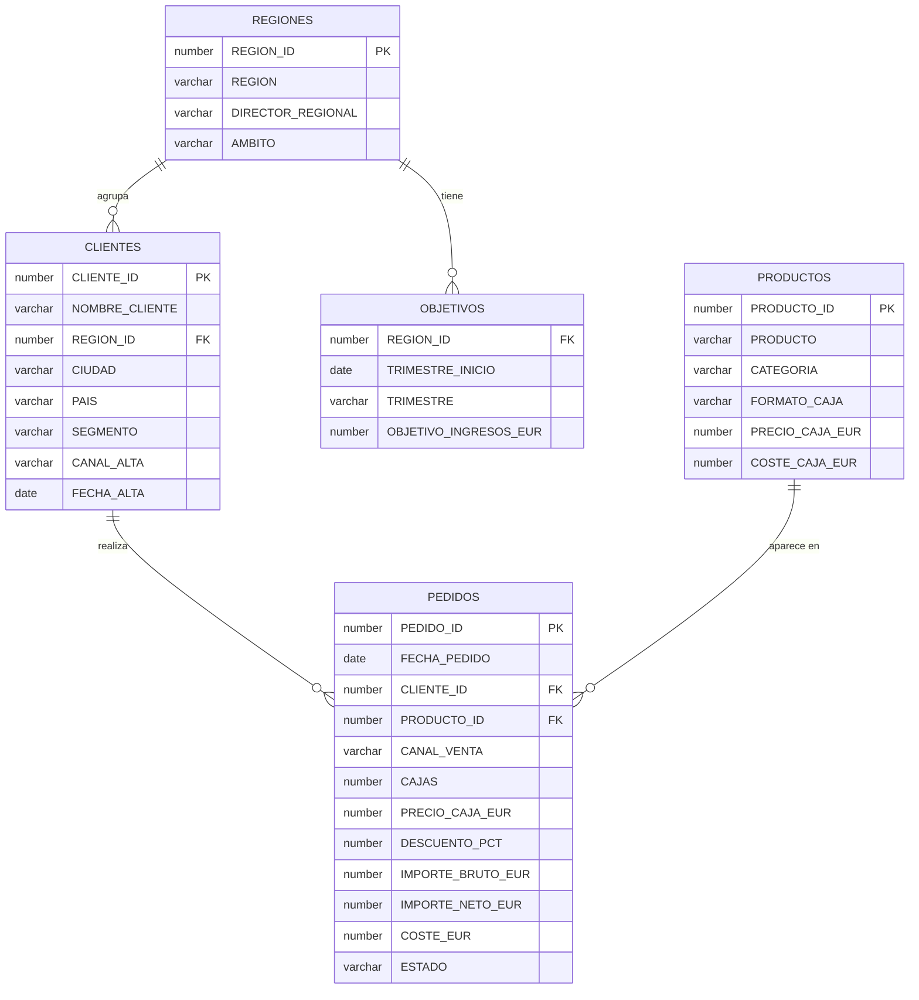

# Modelo de datos · `DEMO_CLAUDE_DATA.VENTAS`

Todas las tablas y columnas llevan comentarios en Snowflake (`COMMENT`). Claude los lee al explorar el esquema, y por eso conviene escribirlos bien.

## Tablas

### `REGIONES` (6 filas)
Mercados comerciales: **Galicia** (mercado local), Centro, Este, Sur, Norte e Internacional (Portugal, Francia, Reino Unido y México).

### `PRODUCTOS` (24 filas)
Conservas vendidas **por caja**. Hay cinco categorías:

| Categoría | Ejemplos |
| --- | --- |
| Moluscos | Mejillones en escabeche, berberechos, zamburiñas, navajas, almejas |
| Cefalópodos | Pulpo en aceite de oliva, calamares en su tinta, chipirones |
| Pescados | Sardinillas, xoubas, bonito del norte, ventresca, atún, caballa |
| Packs y regalo | Pack degustación Rías Baixas, estuche gourmet, lote de Navidad |
| Formato hostelería | Latas de 1 kg de mejillón, pulpo, bonito, berberecho, sardinilla y zamburiña |

### `CLIENTES` (≈ 1.525 filas)

| Columna | Valores |
| --- | --- |
| `SEGMENTO` | Tienda gourmet · Hostelería · Distribuidor · Gran cuenta (cadenas) |
| `CANAL_ALTA` | Web · Comercial directo · Distribuidor · Feria |
| `FECHA_ALTA` | El 60 % son clientes históricos y el 40 % se dio de alta durante el periodo |

### `PEDIDOS` (≈ 55.000-65.000 filas)
Hay una línea por pedido, y **la región del pedido es la del cliente**.

| Regla de negocio | Detalle |
| --- | --- |
| Ingresos | `SUM(IMPORTE_NETO_EUR)` solo con `ESTADO = 'Completado'` |
| Margen | `IMPORTE_NETO_EUR - COSTE_EUR` |
| `ESTADO` | Completado (≈ 92 %) · Devuelto (≈ 5 %) · Cancelado (≈ 3 %) |
| `CANAL_VENTA` | Web · Comercial directo · Distribuidor |

### `OBJETIVOS` (48 filas)
Hay un objetivo de ingresos netos por región y **trimestre completo**: los ingresos del mismo trimestre del año anterior más un 10 %.

### Vista `V_VENTAS_DETALLE`
Junta pedidos, clientes, regiones y productos, y añade `MES`, `TRIMESTRE_INICIO` y `MARGEN_EUR`. Es el punto de partida más cómodo para preguntar en lenguaje natural.
